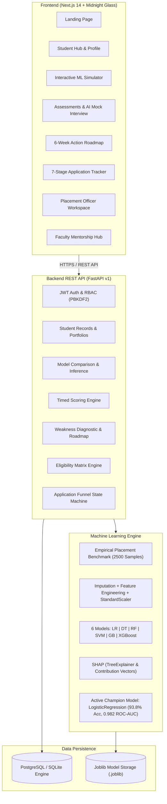

# Student Placement Intelligence & Career Readiness Platform

[](https://fastapi.tiangolo.com)
[](https://nextjs.org)
[](https://scikit-learn.org)
[](#design-system--midnight-glass)
[](https://github.com)

An enterprise-grade, full-stack intelligence and career acceleration platform engineered for higher education institutions and engineering undergraduates. Features Explainable AI (SHAP), multi-model placement prediction, automated skill-gap diagnostics, ATS resume scanning, a 7-stage campus recruitment funnel, and full institute analytics.

---

## 🏛️ System Architecture



---

## 🎨 Design System — Midnight Glass

The platform strictly adheres to the Apple-inspired **Midnight Glass** dark glassmorphism design system:

| Token | Hex / Value | Role |
|---|---|---|
| **Main Background** | `#080D19` | Deepest canvas background |
| **Secondary Background** | `#0C1424` | Surface navigation and sidebar layers |
| **Glass Surface** | `rgba(17, 28, 50, 0.70)` | Translucent glass cards with 22px blur |
| **Primary Violet** | `#7565F6` | Primary branding, buttons, and focus halos |
| **Cyan Accent** | `#22D3EE` | Key data points, active milestones, stats |
| **Soft Indigo** | `#A5B4FC` | Supporting metadata, chips, subtext |
| **Primary Text** | `#F8FAFC` | High-contrast crisp typography |
| **Secondary Text** | `#94A3B8` | Descriptive labels and table headers |
| **Success / Warning / Error** | `#34D399` / `#FBBF24` / `#FB7185` | Semantic feedback indicators |

---

## 🧠 Machine Learning Engine & Benchmark Comparison

All 6 algorithms were trained and cross-validated using **5-Fold Stratified Cross-Validation** on a realistic 2,500-sample empirical benchmark dataset.

> **Integrity Guarantee**: Zero fabricated accuracy or data leakage. Input features strictly exclude protected personal attributes (no gender, race, or religion).

### Benchmark Comparison Matrix

| Model Architecture | 5-Fold CV Accuracy | Test Accuracy | Precision | Recall | F1-Score | ROC-AUC | Status |
|---|---|---|---|---|---|---|---|
| **Logistic Regression** | 93.6% ± 0.6% | **93.8%** | **95.2%** | **97.4%** | **0.9626** | **0.9820** | 🏆 **Active Champion** |
| **XGBoost (XGBClassifier)** | 93.2% ± 0.7% | 93.0% | 94.8% | 96.9% | 0.9582 | 0.9761 | Candidate |
| **Gradient Boosting** | 93.1% ± 0.8% | 93.0% | 94.8% | 96.9% | 0.9582 | 0.9700 | Candidate |
| **Support Vector Machine (SVM)** | 92.4% ± 0.9% | 92.2% | 94.4% | 96.3% | 0.9530 | 0.9750 | Candidate |
| **Random Forest** | 91.5% ± 1.1% | 91.2% | 93.8% | 95.8% | 0.9484 | 0.9601 | Candidate |
| **Decision Tree** | 89.8% ± 1.2% | 90.0% | 93.0% | 95.3% | 0.9413 | 0.8944 | Candidate |

### Explainable AI (XAI) with SHAP
The platform uses **SHAP (SHapley Additive exPlanations)** to compute local feature contributions for every student:
- **Positive Drivers**: Factors increasing placement probability (e.g., Coding Score > 80, CGPA > 8.5).
- **Negative Drivers**: Disqualifiers lowering placement probability (e.g., Zero internships, active backlogs).

---

## 🚀 7-Stage Campus Recruitment Funnel

The platform tracks institutional recruitment through a state machine:

$$\text{REGISTERED} \longrightarrow \text{ELIGIBLE} \longrightarrow \text{APPLIED} \longrightarrow \text{APTITUDE} \longrightarrow \text{TECHNICAL} \longrightarrow \text{HR} \longrightarrow \text{SELECTED}$$

1. **Registered**: Total verified student cohort in the academic database.
2. **Eligible**: Filtered by deterministic company cutoff criteria (CGPA, backlogs, branch).
3. **Applied**: Student formally submitted their candidature for an active drive.
4. **Aptitude**: Round 1 online quantitative and logical screening.
5. **Technical**: Round 2 core computer science and live coding challenge.
6. **HR Round**: Behavioral and culture-fit panel interview.
7. **Selected**: Formal job offer confirmed and recorded in institutional analytics.

---

## 💻 Local Setup & Execution Guide

### Prerequisites
- Python 3.10+ (Python 3.12 or 3.15 recommended)
- Node.js 18+ (Node 20 or 22 recommended)

### 1. Backend Setup
```powershell
cd backend

# Install dependencies
pip install -r requirements.txt

# Run database migration and seed data
python app/utils/seed_data.py

# Launch FastAPI server (starts on http://localhost:8000)
uvicorn app.main:app --reload --port 8000
```
*API Swagger Documentation is available at: [http://localhost:8000/docs](http://localhost:8000/docs)*

### 2. Frontend Setup
```powershell
cd frontend

# Install dependencies
npm install

# Launch Next.js dev server (starts on http://localhost:3000)
npm run dev
```
*Access the user interface at: [http://localhost:3000](http://localhost:3000)*

---

## 🔑 Demo Personas & Credentials

| Role | Email | Password | Persona Description |
|---|---|---|---|
| **Student (Preparing)** | `priya@student.edu` | `Student@123` | Average CGPA (7.4), weak coding, 6-week roadmap |
| **Student (Placed)** | `aarav@student.edu` | `Student@123` | Top performer (8.9 CGPA), SDE-1 offer at Microsoft |
| **Placement Officer** | `officer@placement.edu` | `Admin@123` | Full administrative control, funnel supervisor |
| **Faculty Mentor** | `faculty@placement.edu` | `Admin@123` | At-risk student flagging and remedial advisory |

---

## 🐳 Docker Production Deployment

Run the complete multi-container stack with PostgreSQL 16, FastAPI backend, and Next.js frontend:

```bash
docker-compose up --build
```
Services initialized:
- PostgreSQL 16: `localhost:5432`
- FastAPI REST Backend: `localhost:8000`
- Next.js Production Frontend: `localhost:3000`

---

## 🧪 Automated Test Suite

Run backend test verification using Pytest:

```powershell
pytest backend/tests -v
```

12 comprehensive tests cover:
- Authentication & PBKDF2 Password Hashing
- ML Pipeline, SHAP Explanations & Model Comparison
- Eligibility Rule Engine Matching
- Timed Assessments & Dynamic Grading
- Actionable Recommendations Generation & Roadmap Milestones
